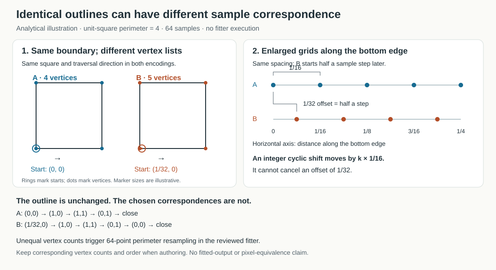

# Authoring compatible SVG silhouettes

For a sequence intended to fit closely, derive each moment from the same polygon, retain corresponding corners, and use translation, rotation and uniform scaling. Keep redundant collinear vertices consistent between moments. The single-cutout fitter approximates incompatible outlines; its reported residual describes sampled geometric error, not every rendered pixel or instant.

This note explains the unchanged fitter used by the [SVG importer](SVG_IMPORT.md). Its mathematical counterexample has been independently checked with exact rational arithmetic; the importer, fitter and renderer were not executed for this analysis. The frozen PR14 receiving course remains unrun, and all original source and receiving files are unchanged.

## Source basis

The source is fixed at commit [`e1b292ee64f78dac6343cc84b73db0ef7f13fbb5`](https://github.com/Jacob-Met/shadow-stage/tree/e1b292ee64f78dac6343cc84b73db0ef7f13fbb5). The locations below refer to these exact files:

| Source | SHA-256 |
|---|---|
| [src/core.js](https://github.com/Jacob-Met/shadow-stage/blob/e1b292ee64f78dac6343cc84b73db0ef7f13fbb5/src/core.js) | `ff7bb9f70fa52fd8348111d35928f3d01804344345af38b55f21e823c422c67b` |
| [tools/import_svg.py](https://github.com/Jacob-Met/shadow-stage/blob/e1b292ee64f78dac6343cc84b73db0ef7f13fbb5/tools/import_svg.py) | `6fd5475c80d45d613c426cd08b8151aa43a2d5a4e5b120291084301ff1434a97` |
| [tools/fit_svg_targets.mjs](https://github.com/Jacob-Met/shadow-stage/blob/e1b292ee64f78dac6343cc84b73db0ef7f13fbb5/tools/fit_svg_targets.mjs) | `802e11b7fd0c4db99f94751476dbfa27a85abc2cbe20bd02be183116d3e8498e` |

## What one planar cutout can represent

`core.js:62–67` projects each fixed local vertex p as

`q = m * (o_xy + R(angle)*p) + (1−m)*l_xy`, where `m = l_z/(l_z−o_z)`.

At any instant this is a translation, rotation and positive uniform scale of the same planar outline. A persistent cutout cannot generally change aspect ratio, shear, bend, grow new notches, change concavity or become its mirror image. A reflected outline may nevertheless be realizable when its own symmetry makes the reflected boundary equivalent to a rotation/translation/scale. Reversing vertex traversal is merely another encoding of the same boundary, not a physical reflection.

Simple concave polygons are allowed; they are not convexified. Their exact boundary is retained as the first physical cutout's outline, subject to scaling and validation (`core.js:7–23,115–119`). Unsupported shape changes are approximated by the fitter and may retain residual. A successful import is not an exact-match certificate.

### Stationary cutout and moving light

If cutout position, depth and angle all stay fixed:

- With fixed light height, magnification is fixed. Moving the light horizontally realizes translations only, with displacement opposite the light motion.
- If light height also changes, positive uniform scaling and translation become possible, but the cutout's orientation remains fixed. Light motion alone does not rotate the silhouette.
- With fixed cutout local-origin position o, desired magnification m>1 and desired projected local-origin position T, required light coordinates are `l_z=m*o_z/(m−1)` and `l_xy=(m*o_xy−T)/(m−1)`. If the local vertices are centered, these positions also give the corresponding centers. The required light coordinates must satisfy all validator limits. These are conditional existence formulas, not a promise of admissibility.

The automatic fitter is more permissive than this stationary-cutout case: it creates both light and cutout tracks. Setting `lightShare=1` assigns authored translation to the light but does not freeze cutout depth or rotation when fitted scale/angle changes. The current fitter fixes light height at 5 and uses cutout depth to realize changing magnification (`core.js:115–122`).

## Constraints that can refuse a mathematical similarity sequence

Validation refuses rather than clamps out-of-range physical parameters. In `core.js:7–23,25–46`, polygon vertices must be finite and within ±100, with 3–512 vertices, nonzero area magnitude at least 1e−8, no adjacent separation below 1e−10, and no intersecting boundary. Keys must increase strictly within [0,1]. Light/cutout x,y,z and angle keys must be finite with absolute value at most 100; light height is at least 0.2 and cutout depth at least 0.01. Maximum cutout depth must be strictly less than minimum light height minus 0.05. This conservative all-key separation is stronger than checking separation only at matching keys. Scene duration must be positive and at most 3600 seconds.

For a stationary cutout, the equations above still have to fit inside these bounds: light height cannot exceed 100, cannot approach cutout height closer than the strict 0.05 separation, and required horizontal light positions must stay within ±100. Thus arbitrary desired scales/translations are not guaranteed. When magnification approaches 1, the required horizontal light displacement for a given translation can become large.

The fitter adds a specific construction restriction. Let s_i be each fitted target similarity scale and let `shrink=min(s_i)/1.4`. It rejects shrink<=1e−6 and uses physical vertices `base*shrink`. Define `S_i=s_i/shrink`; then `S_i>=1.4`, light height is 5 and cutout depth is `5*(1−1/S_i)`. The strict 0.05 separation requires **S_i<100**, hence in real arithmetic:

`max(s_i)/min(s_i) < 100/1.4 = 500/7`.

This is a necessary bound for this construction, not a sufficient general admissibility test. Floating-point rounding near boundaries can affect acceptance. Fitted translation f and lightShare a also require, coordinate by coordinate:

`abs(f*(1−a)/S_i) <= 100` for the cutout,

`abs(f*a/(S_i−1)) <= 100` for the light.

The scaled physical polygon must itself still pass vertex, area and short-edge checks. Centering can make a local base coordinate exceed the original target-coordinate magnitude, so accepted target coordinates alone do not prove physical-vertex admission. Very small fitted scales can also collapse area/edge lengths.

The SVG importer is narrower: 3–128 vertices, 2–16 moments including endpoints, duration<=120 seconds, common positive-sized viewBox, stageWidth in (0,100], shape wholly inside viewBox and mapped coordinates within ±100. Mapping preserves aspect and flips y; it does not automatically fit artwork inside the movie camera.

### Camera framing is a separate limit

The existing [offline exporter](https://github.com/Jacob-Met/shadow-stage/blob/e1b292ee64f78dac6343cc84b73db0ef7f13fbb5/tools/export_video.py) uses a 1000×714 camera that maps `(x,y)` to `(500+260x,350−260y)`. Its nominal visible stage rectangle is x in [−25/13,25/13] and y in [−1.4,35/26]. The physical scene validator does not establish that every projected polygon remains inside this rectangle. Valid targets or a valid scene can still render clipped; interpolation must also be considered. No new clipping/visibility guarantee follows from these source bounds.

## Correspondence: keep meaningful vertices consistent

`core.js:75–90` explicitly searches all cyclic shifts and both traversal directions when target and base have the same vertex count. For truly corresponding vertices of similar outlines, this includes an exact real-arithmetic correspondence despite a different starting vertex or reversed winding. Concavity does not invalidate that argument. Symmetry can leave multiple equally plausible orientations; endpoint outlines alone do not uniquely specify motion.

When counts differ, `core.js:69–90` resamples both boundaries at 64 equal perimeter intervals, then tries only integer cyclic sample shifts. This can make the fit depend on an otherwise irrelevant SVG starting point or collinear vertex.

*Analytical schematic, with Cartesian y upward. It illustrates correspondence samples rather than an executed fit; SVG-to-stage mapping flips y as described above.*

**Unexecuted analytical example:** two SVG polygons in the same unit viewBox, with `stageWidth=1`, are

`[(0,0),(1,0),(1,1),(0,1)]`

and

`[(1/32,0),(1,0),(1,1),(0,1),(0,0)]`.

Both fill exactly the same square, but their 64-point perimeter samples differ by half a sample interval (spacing 1/16, offset 1/32). No integer sample shift aligns them exactly. For one correspondence the centered least-squares quantities are denominator 171/8, dot 341/16 and cross magnitude 1. The best similarity for that correspondence has scale `sqrt(116537)/342`, angle magnitude `atan(16/341)` and summed squared correspondence error 85/5472. This is strictly lower than 1/16, the minimum for any exact-square-preserving similarity on these sample grids. Therefore the chosen correspondence fit cannot preserve the identical square exactly. The importer's y-flip changes rotation sign, not the conclusion. An independent exact-rational calculation checked all 64 shifts and both windings: the minimum fitted error is 85/5472, while the minimum over exact-square-preserving transformations is 1/16. No fitter result was generated to make this argument. Floating-point tie handling may choose a different symmetry-related orientation; this analysis does not identify a runtime-selected orientation.

Practical advice: derive compatible moments from one outline with corresponding vertex counts and meaningful corner positions retained. Avoid adding/removing arbitrary collinear points or changing which geometric points are represented between moments. Keeping the same ordering and start vertex is clearest even though equal-count cyclic/reversed encodings are searched. Equal counts alone do not guarantee compatibility if vertex correspondence or shape differs.

## Interpreting the three error measurements

1. **Fitting objective:** the similarity search minimizes vertex-correspondence RMS, using native vertices for equal counts and 64 resampled points otherwise (`core.js:75–90`). This is a proxy for silhouette agreement.
2. **Reported boundary residual:** `boundaryError` samples 64 points on each polygon and measures their distances to all segments of the opposite polygon. It combines both directed mean squared distances and takes a square root. `authoredKeyRms` then RMS-aggregates the per-key values (`core.js:99–110`). It is neither a continuous Hausdorff bound nor pixel overlap; localized mismatch between samples can be missed.
3. **Intermediate/rendered behavior:** the default report samples 25 normalized times. Its interpolated targets are constructed from aligned 64-point boundaries with smoothstep interpolation (`core.js:92–108`); these are an authoring choice, not observed ground truth. Physical position/depth tracks interpolate separately and angle uses shortest wrapped increments (`core.js:48–59`). Projection is nonlinear in depth, so exact key fits do not imply exact intermediate agreement or a prescribed number of spins. Finite temporal samples do not certify every instant. Rasterization, antialiasing, video sample times, framing and YUV conversion add differences outside the reported stage-coordinate metric.

Use the actual fit report to identify approximation, then inspect the resulting motion and framing when execution is admitted. Neither low sampled residual nor this source analysis establishes fabrication, collision clearance, every-frame accuracy, browser equivalence or artistic success.

## Scale transitions and continuous framing

The companion [motion notes](SVG_MOTION_NOTES.md) derive an intermediate-origin drift that can occur during scale changes, explain the conditional `lightShare=0` authoring choice, and give a sufficient continuous geometric framing bound. These are source-derived results; the frozen importer and receiving course remain unchanged.
